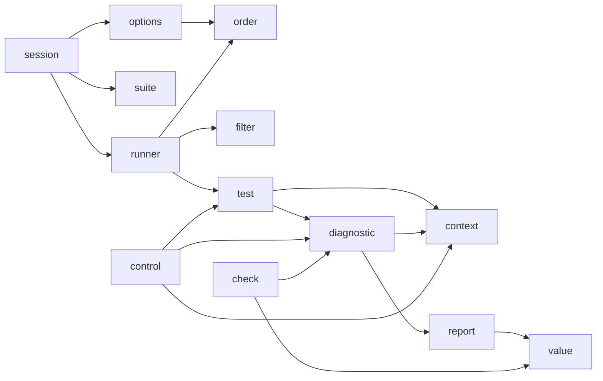

# Architecture

How the sources of Naos are laid out and how the modules depend on each other, for those who maintain and extend it. This page is the reference for the module layout: when a module is added or a dependency changes, update it, together with the dependency comment of `src/CMakeLists.txt`.

## Principles

These decide what goes into Naos, before any feature:

- **Easy to adopt, first**: no dependency besides the standard C library, and no compiler extension. A feature that would cost either of them stays out.
- **The output is a contract**: its lines are read by people and parsed by tools, so their form stays stable and documented ([output](../reference/output.md)).
- **A documented public API**: only what the [reference](../reference/README.md) documents is public and kept compatible.
- **A narrow scope**: process isolation, parallel runs, time limits and report formats are left to the caller (CTest, scripts, CI).

## Directories

| Path | Content |
|---|---|
| `include/naos/` | The public headers. Users are pointed to `naos/naos.h` only |
| `src/` | The implementation and the internal headers |
| `cmake/` | Installed for users: `Naos.cmake` (`naos_add_executable()`, `naos_discover_tests()`), `NaosDiscover.cmake` (the script that lists the tests after a build and registers them with CTest) and the config of `find_package(naos)`. Used by the build of Naos only, not installed: `NaosVersion.cmake` (the version and what follows from it: compatibility, SOVERSION) and `NaosInstall.cmake` (the install rules) |
| `tests/` | The self tests: one directory per subject, with its programs, the `CMakeLists.txt` registering its cases and the expected outputs (`expected/`). See [testing](testing.md) |
| `examples/` | Complete projects quoted by the documentation, built and run by the self tests |
| `docs/` | The documentation in English, and its Japanese translation in `docs/ja/` |
| `scripts/` | Scripts for maintaining Naos, not used by its build: `prepare-release.cmake` and `release-notes.cmake` prepare a release and write its notes, see [releasing](release.md) |
| `.github/` | The workflows (CI and the release) and the templates of issues and pull requests |

## Modules

`src/` is split into one file per concern. A file that implements a public header has its name (`naos/control.h` ↔ `control.c`); the others declare what they share in an internal header of the same name (`diagnostic.c` ↔ `diagnostic.h`). Only an internal header that has a public header of the same name gets `_internal.h` (`suite_internal.h`).

The files form three groups, listed in this order in `src/CMakeLists.txt` and in the table below: the public API (`session.c` to `version.c`), running the tests (`options.c` to `test.c`) and writing what happened (`diagnostic.c` to `value.c`). A new file goes into its group.

| File | Role |
|---|---|
| `session.c` | `naos/session.h`: the order of `naos_init` → `NAOS_ADD_SUITE` → `naos_run` |
| `suite.c` | `naos/suite.h`: registering suites, and finding their mistakes before the run |
| `check.c` | `naos/check.h`: the comparisons of the assertions, and the values printed when they fail |
| `control.c` | `naos/control.h`: `NAOS_NOTE`, `NAOS_TRACE_*`, and the stops of `NAOS_FAIL`, `NAOS_SKIP` and `NAOS_REQUIRE_*` |
| `version.c` | `naos/version.h`: the version at run time |
| `options.c` | The command line (`--naos-*`): parsing, help and usage |
| `runner.c` | The whole run, with repeat, shuffle and fail fast, and the summary |
| `filter.c` | Matching the patterns of `--naos-filter` |
| `order.c` | The order and the seed of `--naos-shuffle` (its own xorshift generator) |
| `test.c` | Running one test: setup, body and teardown, with `setjmp` / `longjmp` |
| `diagnostic.c` | One diagnostic (begin → gather details → end), and the results of the test |
| `context.c` | The note (`NAOS_NOTE`) and the stack of traces that go with diagnostics. Prints nothing |
| `report.c` | The form of every output line (standard output) and the messages of Naos itself (standard error) |
| `value.c` | How values are written in detail lines (escaped strings, shortest doubles) |

Dependencies go one way and never form a cycle. An arrow points at the module used. `report` is used by every module that prints something (`session`, `suite`, `options`, `runner` and others), and the suites as registered (`suite_internal.h`) by every module that reads them (`runner`, `filter`, `test`), so the diagram leaves those arrows out. The dependency comment of `src/CMakeLists.txt` lists them all.

## Key mechanisms

- **Registration**: `NAOS_TEST`, `NAOS_SETUP` and `NAOS_TEARDOWN` define a function whose name holds its role, `naos_gen_<role>_<name>`. `NAOS_ADD_TEST`, `NAOS_SET_SETUP` and `NAOS_SET_TEARDOWN` accept only a function of their own role, so mixing them up does not compile. `NAOS_SUITE` defines a function `naos_gen_suite_<name>` that registers the tests on a builder (`naos_begin_suite`, `naos_add_test`, `naos_set_*`). `NAOS_ADD_SUITE` hands that function to `naos_add_suite`; `naos_run()` calls them to collect the suites, then checks them all before running any test.
- **Stopping**: `test.c` runs setup, body and teardown under `setjmp`. A stop (`naos_stop`) jumps straight back to that `setjmp`, from whichever function the macro was used in.
- **Diagnostics**: every failure goes through `naos_diagnostic_begin()` → `naos_diagnostic_add*()` → `naos_diagnostic_end()`, which adds the note and the traces of `context.c` and prints through `report.c`.
- **State**: shared mutable state lives in `static` variables of each module (`g_` prefix), never in `extern` variables. The one exception is the options, read only after `naos_init`, through `naos_options_get()`.
- **Discovery**: `naos_add_executable()` adds a `POST_BUILD` command that runs `NaosDiscover.cmake` after each build. The script runs `<exe> --naos-list` and writes a CTest file that registers each line of the output as one test. Parameters go through a file, so nothing needs escaping. When listing fails, the build fails, with the cause and what to do in its message, instead of going on with no test ([troubleshooting](../guides/troubleshooting.md#cmake-and-ctest)).
- **Version**: `include/naos/version.h` is the only source of the version. `NaosVersion.cmake` reads it and derives `project(VERSION)`, the package compatibility and the `SOVERSION`.

[Extending](extending.md) tells where each kind of change goes.
