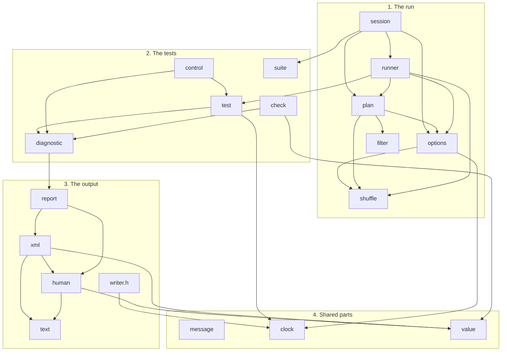

# Architecture

How the sources of Naos are laid out and how the modules depend on each other, for those who maintain and extend it. This page is the reference for the module layout: when a module is added or a dependency changes, update it, together with the dependency comment of `src/CMakeLists.txt`.

## Principles

These decide what goes into Naos, before any feature:

- **Easy to adopt, first**: building needs nothing but a C compiler. No library to install or link, and no compiler extension. A feature that would cost either stays out.
- **One output for people, one for tools**: standard output is for people, and changes between versions. Tools read the JUnit XML file of `--naos-output`. Only what the common tools process is kept compatible ([JUnit XML](../reference/xml.md#compatibility)). In standard output, only the start of a diagnostic line, the names of `--naos-list` and the exit codes are ([output](../reference/output.md#what-is-kept-compatible)).
- **A documented public API**: only what the [reference](../reference/README.md) documents is kept compatible.
- **A narrow scope**: process isolation, parallel runs and time limits are left to the caller (CTest, scripts, CI). Naos writes one report format, and adds others when they are needed.

## Directories

| Path | Content |
|---|---|
| `include/` | The public headers. Users are pointed to `naos/naos.h` only |
| `src/` | The implementation and the internal headers |
| `cmake/` | Installed for users: `Naos.cmake` (`naos_add_executable()`, `naos_discover_tests()`), `NaosDiscover.cmake` (the script that lists the tests after a build and registers them with CTest), `NaosCheckRegistration.cmake` (the check that every test and suite defined is added, included by `NaosDiscover.cmake` or run alone) and the config of `find_package(Naos)`. Used by the build of Naos only, not installed: `NaosVersion.cmake` (the version and what follows from it: compatibility, SOVERSION) and `NaosInstall.cmake` (the install rules) |
| `tests/` | The self tests, in layers by who judges them (`contract/`, `api/`, `unit/`, `behavior/`, `build/`, `examples/`), each with its programs, the `CMakeLists.txt` registering its cases and the expected outputs (`expected/`); `consumer/`, a project using Naos; and their helpers (`harness/`). See [testing](testing.md) |
| `examples/` | Complete projects quoted by the documentation, built and run by the self tests |
| `docs/` | The documentation in English, and its Japanese translation in `docs/ja/` |
| `scripts/` | Scripts for maintaining Naos, not used by its build: `PrepareRelease.cmake` and `ReleaseNotes.cmake` prepare a release and write its notes, see [releasing](release.md); `Lint.cmake` runs the checks that need no build (`CheckMarkdownLinks.cmake`, `CheckPrintfCalls.cmake`, `CheckReleaseScripts.cmake`), see [lint](testing.md#lint); `TestPackage.cmake` tests the package a build installs, see [building](building.md#installing) |
| `.github/` | The workflows (CI and the release) and the templates of issues and pull requests |

## Modules

`src/` is split into one file per concern. A file that implements a public header has its name (`naos/control.h` ↔ `control.c`); the others declare what they share in an internal header of the same name (`diagnostic.c` ↔ `diagnostic.h`). Only an internal header that has a public header of the same name gets `_internal.h` (`suite_internal.h`).

The files form four layers, from the top: the run, the tests, the output and the shared parts. A file uses only files of its own layer or of a layer below it, never one above, `src/CMakeLists.txt` and the table below list the files in this order. A new file goes into the layer of what it does, and a dependency that would go up is a sign that a part of the file belongs to a lower layer.

| Layer | Files | What it is for |
|---|---|---|
| 1. The run | `session`, `options`, `plan`, `runner`, `filter`, `shuffle`, `version` | What happens once for the whole process: the order of the calls of the user, the command line, the choice and order of the tests, the rounds |
| 2. The tests | `suite`, `test`, `control`, `check`, `diagnostic` | The tests as registered, and what happens in one of them: setup, body and teardown, the assertions, the stops, the note and the traces, and the outcome they add up to |
| 3. The output | `report`, `writer.h`, `human`, `xml`, `text` | The events of the run, and how each writer writes them. `writer.h` holds every type the writers are told, such as the outcome and the trace |
| 4. Shared parts | `message`, `clock`, `value`, `format.h` | What layers above use without depending on any other module: the messages of Naos itself, the time, how values are written, the formatted output |

A file that implements a public header is in the layer of what it does: `session.c` and `version.c` are in the run, `suite.c`, `control.c` and `check.c` in the tests.

| File | Role |
|---|---|
| `session.c` | `naos/session.h`: the order of `naos_init` → `NAOS_ADD_SUITE` → `naos_run` |
| `options.c` | The command line (`--naos-*`): parsing, help and usage |
| `plan.c` | Which tests run, and in what order: the selection of `--naos-filter`, the order of `--naos-shuffle` in each round, and the names of `--naos-list` |
| `runner.c` | The rounds of `--naos-repeat` and their seeds, fail fast, the tally and the exit code |
| `filter.c` | Matching a name `<suite>.<test>` against the patterns of `--naos-filter` |
| `shuffle.c` | The generator, the seeds and the shuffle of `--naos-shuffle` (its own xorshift generator) |
| `version.c` | `naos/version.h`: the version at run time |
| `suite.c` | `naos/suite.h`: registering suites, and finding their mistakes before the run |
| `test.c` | Running one test: setup, body and teardown, with `setjmp` / `longjmp`, and its time |
| `control.c` | `naos/control.h`: `NAOS_NOTE`, `NAOS_TRACE_*`, and the stops of `NAOS_FAIL`, `NAOS_SKIP` and `NAOS_REQUIRE_*` |
| `check.c` | `naos/check.h`: the comparisons of the assertions, and the values printed when they fail |
| `diagnostic.c` | One diagnostic (begin → gather details → end), what goes with it (the note of `NAOS_NOTE` and the stack of traces), and the results of the test. Prints nothing itself: it tells the diagnostic through `report.c` |
| `report.c` | Tells the events of the run (a test starts, a diagnostic, a test ends, ...) to every writer on. `writer.h` declares the events and the functions of a writer |
| `human.c` | The writer of the human-readable output: the form of every line on standard output, and which lines a run writes |
| `xml.c` | The writer of the JUnit XML file of `--naos-output xml:<path>`: keeps the results while the tests run and writes the whole file at the end |
| `text.c` | A text that grows as it is added to, for the writers that keep what they write until later |
| `message.c` | The messages of Naos itself (`naos: ...` on standard error), such as a usage error or a lack of memory. Not an event: the writers never see them |
| `clock.c` | The clock that times the tests: the monotonic clock of the operating system, or `clock()`. The only file that depends on the platform |
| `value.c` | How values are written (escaped strings, shortest doubles) |

The layers are a single line, each using every layer below it: the tests use the output because a test writes what happens in it at once (`RUN:` before setup, each failure as it happens), so that what a crashed test wrote is not lost. An arrow points at the module used. The diagram leaves out the arrows to `message`, to `report` other than `diagnostic --> report`, and to the suites as registered (`suite_internal.h`) other than `session --> suite`. The dependency comment of `src/CMakeLists.txt` lists them all.

## Key mechanisms

- **Registration**: `NAOS_TEST`, `NAOS_SETUP` and `NAOS_TEARDOWN` define a function whose name holds its role, `naos_gen_<role>_<name>`. `NAOS_ADD_TEST`, `NAOS_SET_SETUP` and `NAOS_SET_TEARDOWN` accept only a function of their own role, so mixing them up does not compile.
- **Suites**: `NAOS_SUITE` defines a function `naos_gen_suite_<name>` that registers the tests on a builder (`naos_begin_suite`, `naos_add_test`, `naos_set_*`). `NAOS_ADD_SUITE` hands that function to `naos_add_suite`. `naos_run()` calls them to collect the suites, then checks them all before running any test.
- **Stopping**: `test.c` runs setup, body and teardown under `setjmp`. A stop (`naos_stop`) jumps straight back to that `setjmp`, from whichever function the macro was used in.
- **Diagnostics**: every failure goes through `naos_diagnostic_begin()` → `naos_diagnostic_add*()` → `naos_diagnostic_end()`, which adds the note and the traces it keeps and tells the whole diagnostic to the writers through `report.c` at its end. A diagnostic and an assertion that passed (`naos_diagnostic_pass()`) both count as an assertion run; after teardown, `test.c` fails a test that would pass but ran none, with a diagnostic without a location, unless `--naos-allow-no-assertions` is given. A test expected to fail is judged there too: `XFAIL` after a failure, and `XPASS` without one, with a diagnostic at its entry of the suite.
- **Writers**: what the run writes goes through `report.c`, which tells each event to every writer on, in the same order. The modules that run the tests decide what happened and when; only a writer decides how it looks and which of it is written, so each output can change without the others.
- **Times**: `test.c` reads the clock (`clock.c`) once just before setup and once just after teardown, and tells the time with the result of the test. `runner.c` adds the times of a round to its tally, which ends the round. The writers only write them, so standard output and the JUnit XML file always show the same times ([output](../reference/output.md#times)).
- **Clock and OS**: `clock.c` holds every `#if` of `src/` on the operating system. It uses `QueryPerformanceCounter` on Windows, `clock_gettime(CLOCK_MONOTONIC)` on POSIX and `clock()` elsewhere; `--help` says which one measures.
- **Formatted output**: every formatted output of `src/` goes through `format.h`, which picks C99 conforming functions of the C library (the `__mingw_` ones on MinGW). `NAOS_PRINTF_FORMAT` of `naos/export.h` declares the printf-like functions of Naos with the same formats, so the check of the compiler matches what Naos prints.
- **State**: shared mutable state lives in `static` variables of each module (`g_` prefix), never in `extern` variables. The one exception is the options, read only after `naos_init`, through `naos_options_get()`.
- **Discovery**: `naos_add_executable()` adds a `POST_BUILD` command that runs `NaosDiscover.cmake` after each build. The script runs `<exe> --naos-list` and writes a CTest file that registers each line of the output as one test. Parameters go through a file, so nothing needs escaping.
- **Registration check**: before writing the CTest file, `NaosDiscover.cmake` compares the tests listed with the `NAOS_TEST` and `NAOS_SUITE` definitions it finds in the text of the sources of the target (`NaosCheckRegistration.cmake`). It does not rely on the compiler: a suite function has external linkage, which no compiler reports when unused, and MSVC does not report an unused `static` test function in every build. A suite with no test is a mistake in the suites, so that every suite added shows in the list.
- **Discovery failure**: when listing fails, the build fails, with the cause and what to do in its message, instead of going on with no test ([troubleshooting](../guides/troubleshooting.md#cmake-and-ctest)).
- **Version**: `include/naos/version.h` is the only source of the version. `NaosVersion.cmake` reads it and derives `project(VERSION)`, the package compatibility and the `SOVERSION`.

[Extending](extending.md) tells where each kind of change goes.
