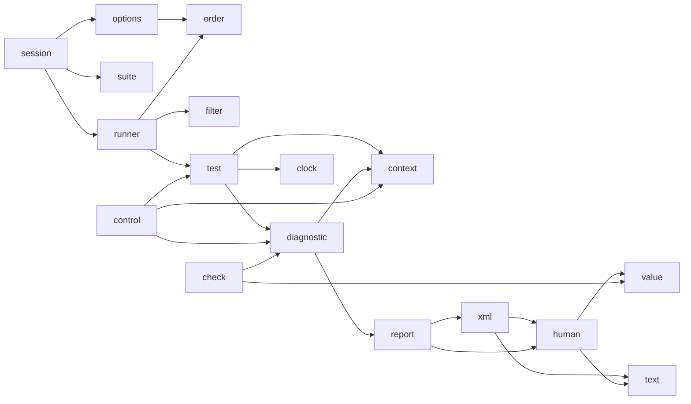

# アーキテクチャ

Naos 自体を保守・拡張する人向けに、ソースの置き方とモジュールの依存の向きを説明します。モジュールの構成はこのページが正です。モジュールを足したり依存を変えたりしたら、ここと、`src/CMakeLists.txt` の依存のコメントを合わせて直します。

## 原則

何を Naos に入れるかは、個々の機能より先に、次の原則で決めます。

- **導入しやすさが最優先**: 標準 C ライブラリ以外に依存しない、コンパイラ拡張を使わない。このどちらかを損なう機能は入れません。ここでいう依存とは、インストールやリンクが必要なライブラリのことです。サポートするどのプラットフォームでもそのどちらも要らない OS の関数は、依存に当たりません。そうした関数は、同じことができるものが標準 C にないときだけ、1 つのファイルの中でだけ使い、それ以外の環境では標準 C で代わりをします。今のところ、`clock.c` の単調時計だけです。`clock()` は POSIX ではプロセッサ時間、Windows では実時間を測るためです。
- **人向けの出力とツール向けの出力を分ける**: 標準出力は人が読むためのもので、読みやすくするためにどのバージョンでも変わることがあります。ツールは `--naos-output` の JUnit XML のファイルを読みます。そのうち JUnit XML を読む一般的なツールが処理するものを契約とし、失敗の内容などほかの部分は、標準出力と同じく人向けです（[JUnit XML](../reference/xml.md#互換性)）。標準出力のうち安定させるのは、ツールがそれなしでは動かないものだけです。エディタが読む診断の行の始まり、CTest への登録が読む `--naos-list` の名前、終了コードです（[出力](../reference/output.md#互換を保つもの)）。
- **公開 API は文書にあるものだけ**: 公開して互換を保つのは、[リファレンス](../reference/README.md)に載せたものだけです。
- **責務を絞る**: プロセスの分離、並列実行、時間制限は呼び出し側（CTest、スクリプト、CI）に任せます。レポートの形式は、Naos だけが知る結果（各失敗の場所と内容）のために 1 つだけ書き、ほかの形式ははっきり必要になったときにだけ足します。

## ディレクトリ

| 場所 | 内容 |
|---|---|
| `include/naos/` | 公開ヘッダ。利用者には `naos/naos.h` だけを案内する |
| `src/` | 実装と内部ヘッダ |
| `cmake/` | 利用者向けにインストールする `Naos.cmake`（`naos_add_executable()` / `naos_discover_tests()`）と `NaosDiscover.cmake`（ビルド後にテストを列挙して CTest に登録するスクリプト）、`find_package(Naos)` 用の config。Naos のビルドだけが使う `NaosVersion.cmake`（バージョンと、そこから決まる互換性・SOVERSION）と `NaosInstall.cmake`（インストール規則）はインストールしない |
| `tests/` | 自己テスト。観点ごとのディレクトリに、プログラム、ケースを登録する `CMakeLists.txt`、期待する出力（`expected/`）を置く（[テスト](testing.md)） |
| `examples/` | 文書が引用する完成したプロジェクト。自己テストでビルドして実行する |
| `docs/` | 英語の文書と、`docs/ja/` にその日本語訳 |
| `scripts/` | Naos の保守に使うスクリプト。ビルドでは使わない。`PrepareRelease.cmake` と `ReleaseNotes.cmake` は、リリースの準備とリリースノートの書き出しをする（[リリース](release.md)）。`CheckLinks.cmake` と `CheckFormat.cmake` は文書とソースを確かめる（[lint](testing.md#lint)） |
| `.github/` | ワークフロー（CI とリリース）と、Issue・プルリクエストのテンプレート |

## モジュール

`src/` は関心ごとのファイルに分けます。公開ヘッダを実装するファイルはそのヘッダと同じ名前にし（`naos/control.h` ↔ `control.c`）、それ以外はモジュール間の宣言を同じ名前の内部ヘッダに置きます（`diagnostic.c` ↔ `diagnostic.h`）。同じ名前の公開ヘッダがある内部ヘッダだけ `_internal.h` を付けます（`suite_internal.h`）。

ファイルは 3 つの群に分かれ、`src/CMakeLists.txt` と下の表ではこの順に並べています。公開 API（`session.c` から `version.c`）、テストの実行（`options.c` から `test.c`）、起きたことの出力（`diagnostic.c` から `value.c`）です。新しいファイルは該当する群に足します。

| ファイル | 役割 |
|---|---|
| `session.c` | `naos/session.h`: `naos_init` → `NAOS_ADD_SUITE` → `naos_run` の順番の管理 |
| `suite.c` | `naos/suite.h`: スイートの登録と、実行前の誤りの検出 |
| `check.c` | `naos/check.h`: アサーションの比較と、失敗したときの値 |
| `control.c` | `naos/control.h`: `NAOS_NOTE`・`NAOS_TRACE_*`・`NAOS_FAIL`・`NAOS_SKIP`・`NAOS_REQUIRE_*` の停止 |
| `version.c` | `naos/version.h`: 実行時のバージョン |
| `options.c` | コマンドライン（`--naos-*`）の解析、ヘルプと使い方 |
| `runner.c` | 繰り返し・シャッフル・fail fast を含む全体の実行と集計 |
| `filter.c` | `--naos-filter` のパターン照合 |
| `order.c` | `--naos-shuffle` の順序と種（自前の xorshift） |
| `test.c` | 1 つのテストの実行（setup・本体・teardown と `setjmp` / `longjmp`）と、その時間 |
| `clock.c` | テストの時間を測る時計。OS の単調時計か `clock()`。プラットフォームに依存する唯一のファイル |
| `diagnostic.c` | 1 つの診断（始め → 詳細を溜める → 終わり）と、テストの結果の集計 |
| `context.c` | 診断に添えるメモ（`NAOS_NOTE`）と trace のスタック。出力はしない |
| `report.c` | 実行のイベント（テストの開始、診断、テストの終了など）を、有効なすべての書き手に伝える。`--naos-list` の名前と、Naos 自身のメッセージ（標準エラー出力）も書く。イベントと書き手の関数は `writer.h` で宣言する |
| `human.c` | 人間向けの出力の書き手。標準出力のすべての行の形と、実行でどの行を書くか |
| `xml.c` | `--naos-output xml:<path>` の JUnit XML のファイルの書き手。テストの実行中は結果を貯め、最後にファイル全体を書く |
| `text.c` | 足すにつれて伸びるテキスト。書いたものを後まで貯める書き手が使う |
| `value.c` | 値の表記（文字列のエスケープ、double の最短表記） |

依存は一方向に保ち、循環させません。矢印の先は使われる側です。`report` は何かを出力するモジュール（`session`・`suite`・`options`・`runner` など）のどれからも、登録されたスイート（`suite_internal.h`）はそれを読むモジュール（`runner`・`filter`・`test`）から使われるので、図ではそれらの矢印を省いています。すべての依存は `src/CMakeLists.txt` の依存のコメントにあります。

## 主な仕組み

- **登録**: `NAOS_TEST`・`NAOS_SETUP`・`NAOS_TEARDOWN` は、役割を名前に含む関数 `naos_gen_<役割>_<name>` を定義します。`NAOS_ADD_TEST`・`NAOS_SET_SETUP`・`NAOS_SET_TEARDOWN` は自分の役割の関数しか受け付けないので、取り違えるとコンパイルできません。`NAOS_SUITE` は、ビルダー（`naos_begin_suite`・`naos_add_test`・`naos_set_*`）にテストを登録する関数 `naos_gen_suite_<name>` を定義します。`NAOS_ADD_SUITE` はこの関数を `naos_add_suite` に渡し、`naos_run()` がそれらを呼んでスイートを集め、テストを実行する前にすべてを検査します。
- **停止**: `test.c` は setup・本体・teardown を `setjmp` の下で実行します。停止（`naos_stop`）は、マクロをどの関数の中で使っていても、この `setjmp` の位置まで一気に戻ります。
- **診断**: 失敗はすべて `naos_diagnostic_begin()` → `naos_diagnostic_add*()` → `naos_diagnostic_end()` を通ります。ここで `context.c` のメモと trace を添え、終わりに診断の全体を `report.c` を通して書き手に伝えます。
- **書き手**: 実行が書くものはすべて `report.c` を通ります。`report.c` は各イベントを、有効なすべての書き手に同じ順で伝えます。何がいつ起きたかはテストを実行するモジュールが決め、それをどう見せ、どれを書くかは書き手だけが決めます。そのため、出力ごとにほかの出力と関係なく変えられます。
- **時間**: `test.c` は setup の直前と teardown の直後に 1 回ずつ時計（`clock.c`）を読み、テストの結果と一緒に時間を伝えます。`runner.c` は 1 回の中のテストの時間を集計に足し、回の終わりに伝えます。書き手はそれを書くだけなので、標準出力と JUnit XML のファイルは常に同じ時間を示します（[出力](../reference/output.md#時間)）。`src/` の中で OS についての `#if` はすべて `clock.c` にあります。Windows では `QueryPerformanceCounter`、POSIX では `clock_gettime(CLOCK_MONOTONIC)`（`-std=c99` のために、どの include よりも前に `_POSIX_C_SOURCE` を定義します。ただし macOS は、定義しなくてもヘッダがすべてを宣言するので除きます）、それ以外では `clock()` を使います。どれで測っているかは `--help` が示します。
- **書式付きの出力**: `src/` の書式付きの出力はすべて `format.h` を通ります。`format.h` は C ライブラリのうち C99 に従う関数を選びます（MinGW では `__mingw_` の関数）。`naos/export.h` の `NAOS_PRINTF_FORMAT` は Naos の printf 形式の関数を同じ書式で宣言するので、コンパイラのチェックと Naos の出力が一致します。
- **状態**: 共有する可変状態は各モジュールの `static` 変数（`g_` 接頭辞）に閉じ、`extern` 変数にはしません。例外は `naos_init` 以後読むだけのオプションで、`naos_options_get()` で読みます。
- **列挙**: `naos_add_executable()` は、ビルド後に `NaosDiscover.cmake` を実行する `POST_BUILD` のコマンドを足します。このスクリプトは `<exe> --naos-list` を実行し、出力の 1 行を 1 件のテストとして登録する CTest のファイルを書きます。パラメータはファイル経由で渡すので、リストをエスケープする必要はありません。列挙に失敗したときは、テストが 0 件のまま黙って進めず、ビルドを失敗させて原因と対処をメッセージに出します（[トラブルシューティング](../guides/troubleshooting.md#cmake-と-ctest)）。
- **バージョン**: バージョンの源は `include/naos/version.h` だけです。`NaosVersion.cmake` がそれを読み、`project(VERSION)`、パッケージの互換性、`SOVERSION` を決めます。

変更の種類ごとの置き場所は[拡張](extending.md)にあります。
