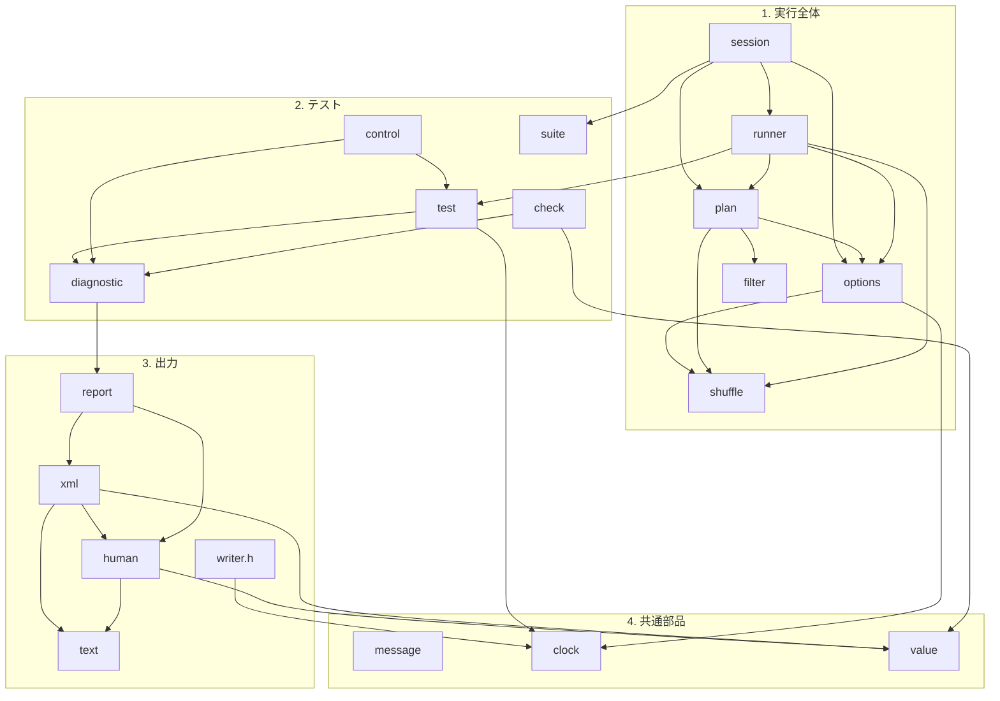

# アーキテクチャ

Naos 自体を保守・拡張する人向けに、ソースの置き方とモジュールの依存の向きを説明します。モジュールの構成はこのページが正です。モジュールを足したり依存を変えたりしたら、ここと、`src/CMakeLists.txt` の依存のコメントを合わせて直します。

## 原則

何を Naos に入れるかは、個々の機能より先に、次の原則で決めます。

- **導入しやすさが最優先**: ビルドに必要なのは C コンパイラだけにします。インストールやリンクが要るライブラリには依存せず、コンパイラ拡張も使いません。どちらかを損なう機能は入れません。
- **人向けの出力とツール向けの出力を分ける**: 標準出力は人向けで、バージョンによって変わります。ツールは `--naos-output` の JUnit XML を読みます。互換を保つのは、一般的なツールが処理する部分だけです（[JUnit XML](../reference/xml.md#互換性)）。標準出力で互換を保つのは、診断の行の始まり、`--naos-list` の名前、終了コードだけです（[出力](../reference/output.md#互換を保つもの)）。
- **公開 API は文書にあるものだけ**: 互換を保つのは、[リファレンス](../reference/README.md)に載せたものだけです。
- **責務を絞る**: プロセスの分離、並列実行、時間制限は呼び出し側（CTest、スクリプト、CI）に任せます。レポートの形式は 1 つだけ書き、ほかは必要になったときに足します。

## ディレクトリ

| 場所 | 内容 |
|---|---|
| `include/` | 公開ヘッダ。利用者には `naos/naos.h` だけを案内する |
| `src/` | 実装と内部ヘッダ |
| `cmake/` | 利用者向けにインストールする `Naos.cmake`（`naos_add_executable()` / `naos_discover_tests()`）と `NaosDiscover.cmake`（ビルド後にテストを列挙して CTest に登録するスクリプト）、`find_package(Naos)` 用の config。Naos のビルドだけが使う `NaosVersion.cmake`（バージョンと、そこから決まる互換性・SOVERSION）と `NaosInstall.cmake`（インストール規則）はインストールしない |
| `tests/` | 自己テスト。判定するものごとの層（`contract/`、`api/`、`unit/`、`behavior/`、`build/`、`examples/`）に、プログラム、ケースを登録する `CMakeLists.txt`、期待する出力（`expected/`）を置く。Naos を使うプロジェクト `consumer/` と、仕組み（`harness/`）もある（[テスト](testing.md)） |
| `examples/` | 文書が引用する完成したプロジェクト。自己テストでビルドして実行する |
| `docs/` | 英語の文書と、`docs/ja/` にその日本語訳 |
| `scripts/` | Naos の保守に使うスクリプト。ビルドでは使わない。`PrepareRelease.cmake` と `ReleaseNotes.cmake` は、リリースの準備とリリースノートの書き出しをする（[リリース](release.md)）。`Lint.cmake` はビルドが要らない検査（`CheckMarkdownLinks.cmake`、`CheckPrintfCalls.cmake`、`CheckReleaseScripts.cmake`）を実行する（[lint](testing.md#lint)）。`TestPackage.cmake` はビルドがインストールするパッケージをテストする（[ビルド](building.md#インストールする)） |
| `.github/` | ワークフロー（CI とリリース）と、Issue・プルリクエストのテンプレート |

## モジュール

`src/` は関心ごとのファイルに分けます。公開ヘッダを実装するファイルはそのヘッダと同じ名前にし（`naos/control.h` ↔ `control.c`）、それ以外はモジュール間の宣言を同じ名前の内部ヘッダに置きます（`diagnostic.c` ↔ `diagnostic.h`）。同じ名前の公開ヘッダがある内部ヘッダだけ `_internal.h` を付けます（`suite_internal.h`）。

ファイルは上から順に、実行全体、テスト、出力、共通部品の 4 つの層に分かれます。ファイルが使うのは同じ層か下の層のファイルだけで、上の層は使いません。`src/CMakeLists.txt` と下の表ではこの順に並べています。新しいファイルはその役割の層に足します。上の層への依存が必要になったら、そのファイルの一部が下の層に属するという合図です。

| 層 | ファイル | 役割 |
|---|---|---|
| 1. 実行全体 | `session`、`options`、`plan`、`runner`、`filter`、`shuffle`、`version` | プロセス全体で 1 回だけ起きること。利用者の呼び出しの順番、コマンドライン、テストの選択と順序、繰り返しの各回 |
| 2. テスト | `suite`、`test`、`control`、`check`、`diagnostic` | 登録されたテストと、1 つのテストの中で起きること。setup・本体・teardown、アサーション、停止、メモと trace、それらから決まる結果 |
| 3. 出力 | `report`、`writer.h`、`human`、`xml`、`text` | 実行のイベントと、それを各書き手がどう書くか。結果や trace など、書き手に伝える型はすべて `writer.h` にある |
| 4. 共通部品 | `message`、`clock`、`value`、`format.h` | 上の層から使われ、ほかのモジュールを使わないもの。Naos 自身のメッセージ、時間、値の表記、書式付きの出力 |

公開ヘッダを実装するファイルは、役割の層に入ります。`session.c` と `version.c` は実行全体、`suite.c`・`control.c`・`check.c` はテストの層です。

| ファイル | 役割 |
|---|---|
| `session.c` | `naos/session.h`: `naos_init` → `NAOS_ADD_SUITE` → `naos_run` の順番の管理 |
| `options.c` | コマンドライン（`--naos-*`）の解析、ヘルプと使い方 |
| `plan.c` | どのテストをどの順で実行するか。`--naos-filter` による選択、各回の `--naos-shuffle` の順序、`--naos-list` の名前 |
| `runner.c` | `--naos-repeat` の各回とその種、fail fast、集計と終了コード |
| `filter.c` | 名前 `<suite>.<test>` と `--naos-filter` のパターンの照合 |
| `shuffle.c` | `--naos-shuffle` の乱数生成器・種・シャッフル（自前の xorshift） |
| `version.c` | `naos/version.h`: 実行時のバージョン |
| `suite.c` | `naos/suite.h`: スイートの登録と、実行前の誤りの検出 |
| `test.c` | 1 つのテストの実行（setup・本体・teardown と `setjmp` / `longjmp`）と、その時間 |
| `control.c` | `naos/control.h`: `NAOS_NOTE`・`NAOS_TRACE_*`・`NAOS_FAIL`・`NAOS_SKIP`・`NAOS_REQUIRE_*` の停止 |
| `check.c` | `naos/check.h`: アサーションの比較と、失敗したときの値 |
| `diagnostic.c` | 1 つの診断（始め → 詳細を溜める → 終わり）と、それに添えるもの（`NAOS_NOTE` のメモと trace のスタック）、テストの結果の集計。自分では出力せず、診断は `report.c` を通して伝える |
| `report.c` | 実行のイベント（テストの開始、診断、テストの終了など）を、有効なすべての書き手に伝える。イベントと書き手の関数は `writer.h` で宣言する |
| `human.c` | 人間向けの出力の書き手。標準出力のすべての行の形と、実行でどの行を書くか |
| `xml.c` | `--naos-output xml:<path>` の JUnit XML のファイルの書き手。テストの実行中は結果を貯め、最後にファイル全体を書く |
| `text.c` | 足すにつれて伸びるテキスト。書いたものを後まで貯める書き手が使う |
| `message.c` | Naos 自身のメッセージ（標準エラー出力の `naos: ...`）。使い方の誤りやメモリ不足など。イベントではないので、書き手には伝わらない |
| `clock.c` | テストの時間を測る時計。OS の単調時計か `clock()`。プラットフォームに依存する唯一のファイル |
| `value.c` | 値の表記（文字列のエスケープ、double の最短表記） |

層は一直線に並び、それぞれが下のすべての層を使います。テストの層が出力の層を使うのは、テストの中で起きたことをその場で書くためです（setup の前に `RUN:`、失敗は起きたときに書く）。そのため、クラッシュしたテストが書いたものも失われません。矢印の先は使われる側です。図では、`message` への矢印、`diagnostic --> report` 以外の `report` への矢印、`session --> suite` 以外の登録されたスイート（`suite_internal.h`）への矢印を省いています。すべての依存は `src/CMakeLists.txt` の依存のコメントにあります。

## 主な仕組み

- **登録**: `NAOS_TEST`・`NAOS_SETUP`・`NAOS_TEARDOWN` は、役割を名前に含む関数 `naos_gen_<役割>_<name>` を定義します。`NAOS_ADD_TEST`・`NAOS_SET_SETUP`・`NAOS_SET_TEARDOWN` は自分の役割の関数しか受け付けないので、取り違えるとコンパイルできません。
- **スイート**: `NAOS_SUITE` は、ビルダー（`naos_begin_suite`・`naos_add_test`・`naos_set_*`）にテストを登録する関数 `naos_gen_suite_<name>` を定義します。`NAOS_ADD_SUITE` はこの関数を `naos_add_suite` に渡します。`naos_run()` はそれらを呼んでスイートを集め、テストを実行する前にすべてを検査します。
- **停止**: `test.c` は setup・本体・teardown を `setjmp` の下で実行します。停止（`naos_stop`）は、マクロをどの関数の中で使っていても、この `setjmp` の位置まで一気に戻ります。
- **診断**: 失敗はすべて `naos_diagnostic_begin()` → `naos_diagnostic_add*()` → `naos_diagnostic_end()` を通ります。ここで、`diagnostic.c` が持っているメモと trace を添え、終わりに診断の全体を `report.c` を通して書き手に伝えます。診断も、成功したアサーション（`naos_diagnostic_pass()`）も、実行したアサーションとして数えます。teardown の後、成功するはずなのにアサーションを 1 つも実行しなかったテストを、`--naos-allow-no-assertions` がなければ `test.c` が場所のない診断で失敗にします。失敗するはずのテストもここで判定します。失敗があれば `XFAIL`、なければ `XPASS` とし、スイートの項目の場所で診断を出します。
- **書き手**: 実行が書くものはすべて `report.c` を通ります。`report.c` は各イベントを、有効なすべての書き手に同じ順で伝えます。何がいつ起きたかはテストを実行するモジュールが決め、それをどう見せ、どれを書くかは書き手だけが決めます。そのため、出力ごとにほかの出力と関係なく変えられます。
- **時間**: `test.c` は setup の直前と teardown の直後に 1 回ずつ時計（`clock.c`）を読み、テストの結果と一緒に時間を伝えます。`runner.c` は 1 回の中のテストの時間を集計に足し、回の終わりに伝えます。書き手はそれを書くだけなので、標準出力と JUnit XML のファイルは常に同じ時間を示します（[出力](../reference/output.md#時間)）。
- **時計と OS**: `src/` の中で OS についての `#if` はすべて `clock.c` にあります。Windows では `QueryPerformanceCounter`、POSIX では `clock_gettime(CLOCK_MONOTONIC)`、それ以外では `clock()` を使います。どれで測っているかは `--help` が示します。
- **書式付きの出力**: `src/` の書式付きの出力はすべて `format.h` を通ります。`format.h` は C ライブラリのうち C99 に従う関数を選びます（MinGW では `__mingw_` の関数）。`naos/export.h` の `NAOS_PRINTF_FORMAT` は Naos の printf 形式の関数を同じ書式で宣言するので、コンパイラのチェックと Naos の出力が一致します。
- **状態**: 共有する可変状態は各モジュールの `static` 変数（`g_` 接頭辞）に閉じ、`extern` 変数にはしません。例外は `naos_init` 以後読むだけのオプションで、`naos_options_get()` で読みます。
- **列挙**: `naos_add_executable()` は、ビルド後に `NaosDiscover.cmake` を実行する `POST_BUILD` のコマンドを足します。このスクリプトは `<exe> --naos-list` を実行し、出力の 1 行を 1 件のテストとして登録する CTest のファイルを書きます。パラメータはファイル経由で渡すので、リストをエスケープする必要はありません。
- **列挙の失敗**: 列挙に失敗したときは、テストが 0 件のまま黙って進めず、ビルドを失敗させて原因と対処をメッセージに出します（[トラブルシューティング](../guides/troubleshooting.md#cmake-と-ctest)）。
- **バージョン**: バージョンの源は `include/naos/version.h` だけです。`NaosVersion.cmake` がそれを読み、`project(VERSION)`、パッケージの互換性、`SOVERSION` を決めます。

変更の種類ごとの置き場所は[拡張](extending.md)にあります。
